<h1 align="center">Planchettes</h1>

<p align="center">
  <strong>Step-by-step building instructions for wooden planks, like the ones that come with brick sets.</strong><br>
  48 models, a 3D view you can turn, the planks to take at each step, and a plan to put them in the right place.
</p>

<p align="center">
  <a href="https://arimet.github.io/planchettes/"><strong>Open Planchettes →</strong></a>
</p>

<p align="center">
  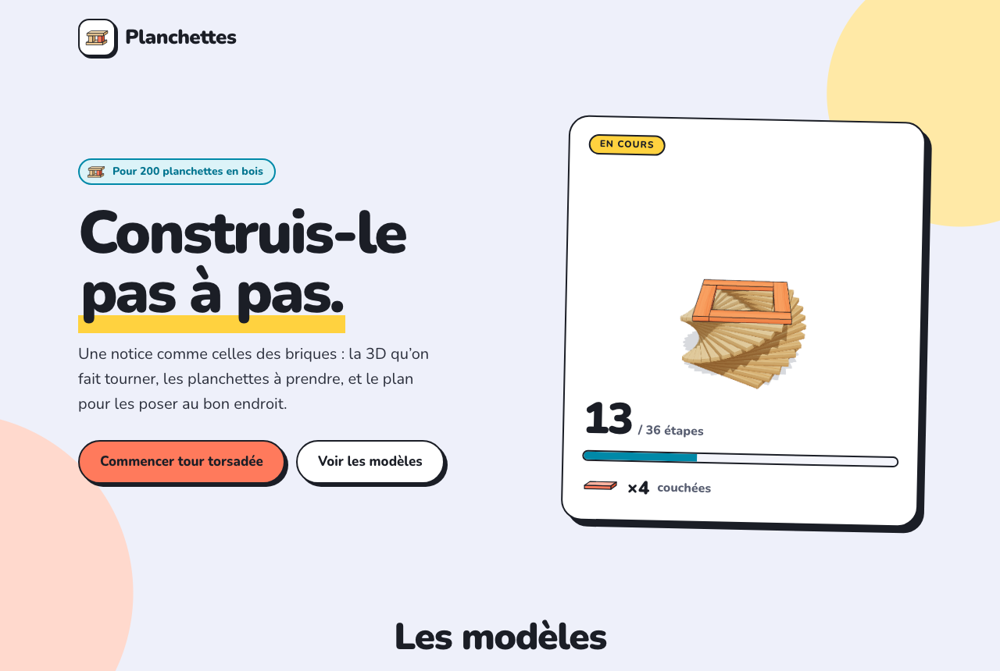
</p>

## Why

At home we build with a box of 200 wooden planks (the Kapla kind). Ideas run out fast, and the books show finished models, not how to get there. Children already know how to follow a brick-set app: one step at a time, the new pieces highlighted, a big arrow to go on. Planchettes does the same for planks.

The interface is in French; it was made for a French-speaking child.

## How a notice works

<p align="center">
  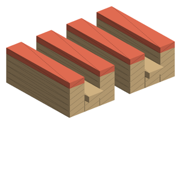
  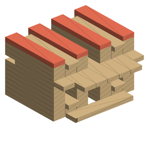
  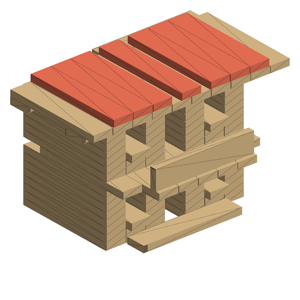
  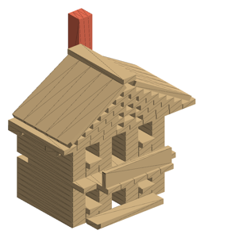
</p>

- **One step, a few planks.** Each step adds 1 to 8 planks. The new ones drop into place in coral; the ones already placed stay natural wood.
- **"Prends ×4 couchées".** A card says how many planks to take and in which position: lying flat, on edge, standing, or leaning.
- **The plan.** A drawer shows the step seen from above and from the front, each new plank numbered in placing order, framed on the step so the numbers stay readable.
- **Turn it.** Drag the 3D view to see the model from any side. Swipe or use the arrow keys to change step. The current step is remembered for each model.

### Install it

Planchettes is a web app: on a phone or tablet, use "Add to Home Screen" to open it full screen with its own icon. Notices you have opened keep working offline.

## The models

<p align="center">
  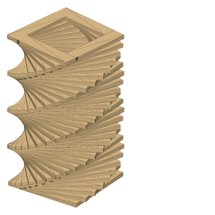
  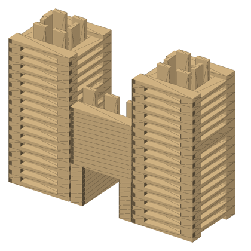
  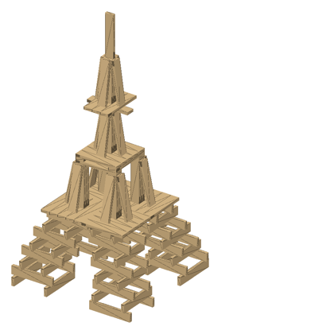
  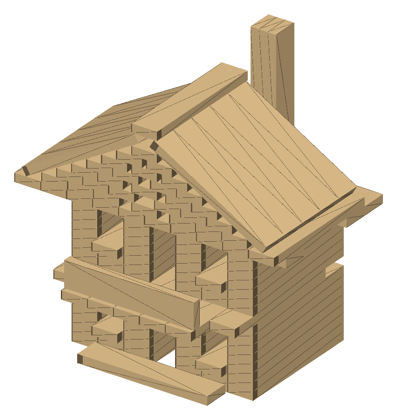
  <br>
  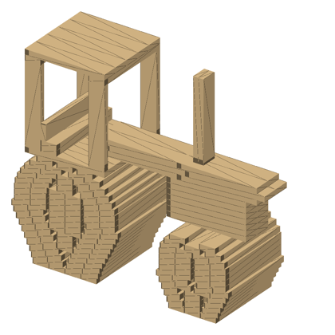
  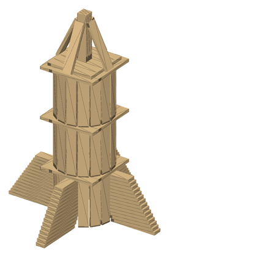
  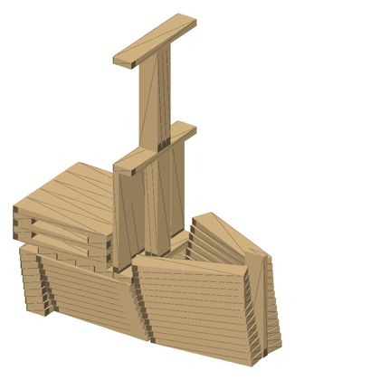
  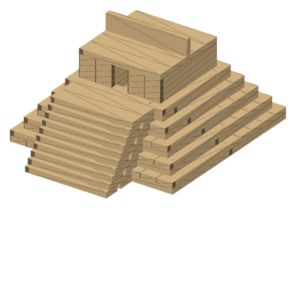
</p>

Every model fits in a box of 200 planks.

| Model | Theme | Planks | Steps | Level |
|---|---|---:|---:|:---:|
| Tour torsadée | Towers | 144 | 36 | ●●○ |
| Château fort | Towers | 185 | 37 | ●●● |
| Fusée | Originals | 128 | 28 | ●●○ |
| Bateau pirate | Originals | 84 | 25 | ●●● |
| Pont en arche | Bridges | 99 | 17 | ●●○ |
| Igloo | Houses | 125 | 24 | ●●○ |
| Maison | Houses | 139 | 32 | ●●● |
| Chalet | Houses | 92 | 22 | ●●○ |
| Girafe | Animals | 105 | 21 | ●●○ |
| Locomotive | Vehicles | 140 | 34 | ●●○ |
| Phare | Towers | 80 | 17 | ●●○ |
| Tour Eiffel | Monuments | 132 | 24 | ●●● |
| Pyramide maya | Monuments | 162 | 40 | ●●○ |
| Araignée | Animals | 48 | 17 | ●●○ |
| Chouette | Animals | 112 | 30 | ●●○ |
| Tracteur | Vehicles | 187 | 49 | ●●○ |
| Avion | Vehicles | 90 | 21 | ●●○ |
| Viaduc | Bridges | 198 | 39 | ●●○ |
| Pagode | Towers | 119 | 33 | ●●● |
| Dinosaure | Animals | 142 | 24 | ●●● |
| Sapin de Noël | Originals | 120 | 31 | ●●○ |
| Gratte-ciel | Towers | 90 | 26 | ●●○ |
| Tour de Pise | Monuments | 96 | 19 | ●●● |
| Big Ben | Monuments | 120 | 21 | ●●○ |
| Arc de triomphe | Monuments | 189 | 33 | ●●○ |
| Colisée | Monuments | 180 | 36 | ●●● |
| Robot | Originals | 109 | 28 | ●●○ |
| Hélicoptère | Vehicles | 47 | 20 | ●●○ |
| Crocodile | Animals | 118 | 24 | ●●○ |
| Tortue | Animals | 107 | 24 | ●●○ |
| Grue | Vehicles | 103 | 28 | ●●● |
| Cabane dans l’arbre | Houses | 112 | 23 | ●●● |
| Spirale de dominos | Originals | 60 | 10 | ●○○ |
| Stonehenge | Monuments | 123 | 30 | ●○○ |
| Parthénon | Monuments | 144 | 26 | ●●○ |
| Torii | Monuments | 31 | 13 | ●○○ |
| Grande Muraille | Monuments | 198 | 40 | ●●○ |
| Escalier en colimaçon | Originals | 80 | 40 | ●●○ |
| Château de cartes | Originals | 70 | 34 | ●●● |
| Église | Houses | 128 | 25 | ●●● |
| Pingouin | Animals | 155 | 37 | ●●○ |
| Lapin | Animals | 95 | 24 | ●●○ |
| Baleine | Animals | 93 | 22 | ●●○ |
| Papillon | Animals | 127 | 27 | ●○○ |
| Camion de pompiers | Vehicles | 134 | 33 | ●●● |
| Voiture de course | Vehicles | 69 | 33 | ●●○ |
| Sous-marin | Vehicles | 94 | 27 | ●●○ |
| Navette spatiale | Originals | 90 | 20 | ●●● |

## Every model really stands

A 3D model can float; real planks can't. So every model is checked by a physics simulation ([Rapier](https://rapier.rs)) before it ships:

1. **After every single plank**, in placing order, the half-built model must stand. A child builds one plank at a time, so a step that only holds once it is finished is not good enough.
2. **With a child's hands.** The finished model is rebuilt ten times with every plank shifted at random by up to 4 mm, and must not collapse.
3. **The rules of the box:** at most 200 planks, no two planks in the same place, nothing below the floor, and every new plank visible with its number in the plan.

`npm test` runs all of it, and the deploy only happens when it passes. The simulation is a safety net, not a guarantee: models are also built for real.

## How a model is made

A model is a TypeScript file: a list of steps, each a list of planks in placing order. A plank is its center, one of six positions, and optionally a rotation around the vertical axis (`yaw`) and a lean (`tilt`). Small helpers place planks by their corner or turn them around a point.

```ts
// src/models/tour-torsadee.ts: four planks around a square, each floor turned 10° more
steps: Array.from({ length: 36 }, (_, i) => ({
  planks: ring(i).map((p) => spin(p, i * 10, 9, 9)),
})),
```

The same data draws everything: the 3D view (Three.js), the 2D plans (SVG) and the plank counts.

## Run it

```bash
npm install
npm run dev     # the site on http://localhost:5173
npm test        # geometry, plans and the physics checks for every model
npm run build   # the static site in dist/
```

### Designing a new model

```bash
MODEL=src/models/my-model.ts npx vitest run tests/one.test.ts   # check one model
npx tsx scripts/render.ts src/models/my-model.ts my-model.png   # see it from the app's angle
npx tsx scripts/preview.ts src/models/my-model.ts               # front, side, top and 3/4
```

Then add it to `src/models/index.ts`. Models that stand but don't look right yet wait in `src/models/drafts/`.

## Built with

Vite, TypeScript, Three.js, Rapier (tests only), Vitest, and the Nunito typeface.

Planchettes is a personal project. It is not affiliated with KAPLA®, which is a registered trademark of its owner.

## License

[MIT](LICENSE)
